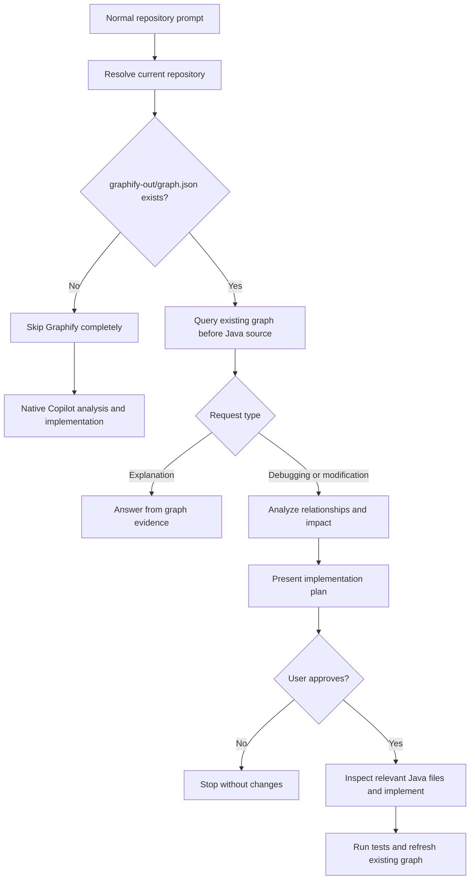

# Graphify Copilot Workflow

The Copilot CLI and VS Code integrations use an automatic, conditional graph-first workflow. This document describes the implementation at commit `841ac92`.

## Normal prompt handling

1. Copilot invokes the installed prompt hook. No `/graphify` command is required.
2. Graphify resolves the current repository from Copilot's working directory. It supports subdirectories and avoids borrowing a graph from an unrelated outer repository.
3. It checks whether `graphify-out/graph.json` exists before analysis or permission gates.
4. If absent, the hooks return an empty result: no graph generation, warning, blocking, or `/repo-analyzer` request. Copilot uses its normal tools and permissions.
5. If present, Graphify queries stored classes, methods, API mappings, calls, and dependencies. Hook output includes `Queried existing graph: <path>`.
6. Graph evidence reaches Copilot through the transformed prompt or the pre-tool hook. Premature source tools are denied.

## Explanations

Explanations use graph evidence and report gaps instead of opening Java files to replace graph analysis.

An existing stale, corrupt, or insufficient graph does not trigger the missing-graph fallback. Graphify reports the problem or requires refresh before implementation.

## Debugging and code changes

1. Query the graph and analyze the relevant relationships and impact.
2. Present the implementation plan and request approval once for the task.
3. After approval, inspect only relevant Java files and implement the scoped changes.
4. Run appropriate tests.
5. Refresh the existing graph within the approved plan.

Copilot's own permission settings still apply. In the approval-hook adapter, a matching host-completed operation records task approval; subsequent operations receive no additional Graphify approval prompt. A new task requires new approval, and rejection stops changes.

## Project components

| Component | Responsibility |
| --- | --- |
| [copilot_install.py](../graphify/copilot_install.py) | Install and migrate the shared hooks |
| [copilot_hooks.py](../graphify/copilot_hooks.py) | Repository resolution, graph checks, queries, context delivery, and approval state |
| [serve.py](../graphify/serve.py), [graph_first.py](../graphify/graph_first.py) | MCP context, impact analysis, and graph synchronization |
| [Java extractors](../graphify/extractors/), [build.py](../graphify/build.py), [watch.py](../graphify/watch.py) | Manual graph generation and incremental updates |
| [api_docs.py](../graphify/api_docs.py) | Generate API documentation from stored evidence |

## Activation and limits

The integration must be installed and hooks enabled. Ordinary repository prompts then activate the workflow automatically; no slash command or manual graph query is needed.

Unsupported chat modes, disabled hooks, IDE indexing, and already attached Java context cannot be controlled by these hooks. Automated tests validate the integration adapter, not a live Copilot UI session.

Manual graph generation, graph queries, updates, and API documentation commands remain available when explicitly requested.

See the [workflow audit](GRAPH_FIRST_WORKFLOW_AUDIT.md) for implementation details, migration instructions, and regression coverage.
